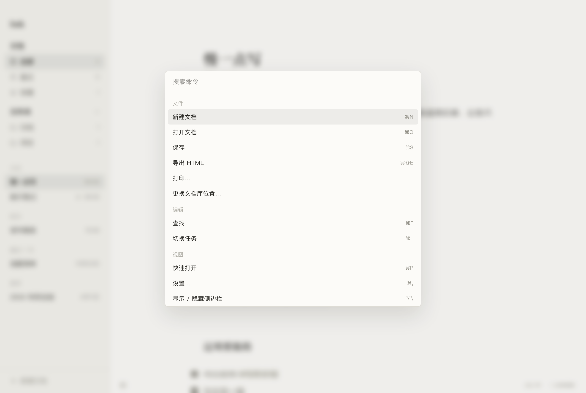
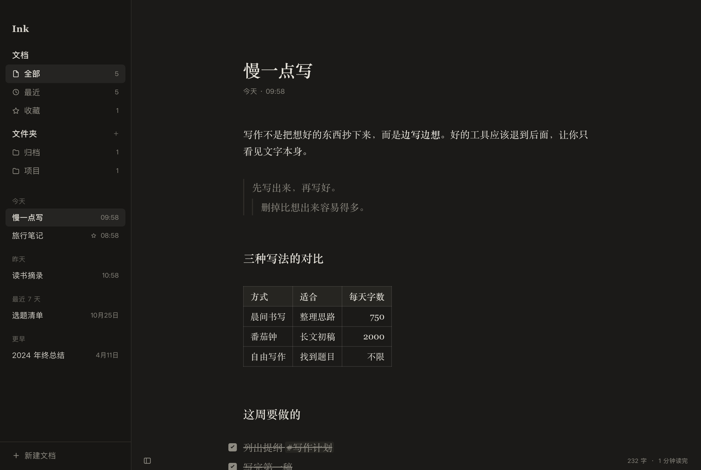

<p align="center">
  
</p>

<h1 align="center">Ink</h1>

<p align="center">
  安静的 Mac Markdown 写作软件。<br>
  打开就写，文档是你磁盘上的普通 <code>.md</code> 文件。
</p>

<p align="center">
  <a href="https://github.com/gq-guo/ink-writer/releases/latest"><strong>下载最新版</strong></a>
  ·
  macOS 10.15+ · Apple Silicon 与 Intel
  ·
  简体中文 / English
</p>

<p align="center">
  
</p>

---

## 为什么是 Ink

**写的时候看到的就是排好版的文字。** 光标不在的地方，`#`、`**`、`>` 这些符号收起来，表格画成表格、任务变成复选框；光标移回去，源码原样出现。不用在「编辑」和「预览」之间来回切。

**文件永远是你的。** 没有账号、没有私有格式、没有云端。文档就存在你选的文件夹里，用任何编辑器都能打开，放进 iCloud Drive 或同步盘也照常工作。

**界面退到后面。** 工具栏平时藏起来，连续打字时状态栏和目录也会淡出。暖纸色的页面、衬线字体，像在一本正在排版的书上写字。

---

## 专注

<p align="center">
  
</p>

- **Focus Mode**（⌘⇧F）只留下你正在写的那一段，其余内容淡出，按 Esc 回来
- **Typewriter Mode**（⌘⇧T）让当前行始终停在屏幕中央，视线不用跟着往下走
- 写作字体、字号、行高、栏宽随手调；内置 iA Writer Quattro、Noto 宋体、霞鹜文楷与 JetBrains Mono

## 写得出来的格式，都排得好看

- 标题、粗体、斜体、删除线、行内代码
- **表格**：按分隔行对齐，单元格里的格式照常显示；点进去就是源码
- **引用**：多层引用一层一条竖线
- **列表与任务**：圆点按层级变化，`- [ ]` 变成可以点的复选框，⌘L 切换
- **代码块**：按语言高亮，语言名作为右上角的小标签
- **图片**：拖进来或直接粘贴，自动存到文档旁的 `assets/`，在正文里直接显示
- **链接**：只显示文字，⌘Click 打开
- 不喜欢收起符号？设置里一键改成始终显示源码

## 整理与查找

<p align="center">
  
</p>

- **侧边栏**：全部 / 最近 / 收藏，按今天、昨天、最近 7 天、更早分组；文件夹可以新建、重命名、把文档移进去
- **行内标签**：正文里写 `#写作计划`，在 Quick Open 里输入 `#` 就能找到全库的标签
- **Quick Open**（⌘P）按文件名模糊搜索，同时搜正文
- **命令面板**（⌘K）所有功能一处可达
- **悬浮目录**：正文右侧一列短横线，悬停展开成目录，点击跳转
- **字数统计**：中文按字、英文按词，附阅读时长

## 深色模式

<p align="center">
  
</p>

浅色 / 深色跟随系统，也可以在设置里固定，⌘⇧D 随时切换。

## 安全可靠

- **自动保存**：停笔即保存；写入是原子操作，断电或崩溃也不会留下写了一半的文件
- **外部修改**：文件被别的程序改了，Ink 自动载入新内容；你手上也有没保存的改动时，可以选保留自己的版本、加载磁盘版本或另存一份
- **一字不改**：磁盘上永远是标准 Markdown；输入 `--` 不会被系统换成破折号，引号也不会被换成弯引号
- **旧文件也能开**：自动识别 GBK 编码并转成 UTF-8，兼容 Windows 换行
- **大文件不卡**：超过 10MB 自动进入性能模式

## 像一个 Mac 软件

- 完整的原生菜单栏，⌘, 打开设置
- 在 Finder 里双击 `.md`、用「打开方式」，或拖到 Dock 图标上就能打开
- 导出单个 HTML 文件，或通过系统打印存成 PDF
- 输入时检查拼写（可关闭）；中文输入法组字时不会误触快捷键
- 应用内自动更新

---

## 安装

**一行命令（推荐）**

```bash
curl -fsSL https://raw.githubusercontent.com/gq-guo/ink-writer/main/scripts/install.sh | sh
```

脚本从 [GitHub Releases](https://github.com/gq-guo/ink-writer/releases) 下载最新版本，校验 SHA-256 后装进「应用程序」。

**手动安装**

从 [Releases](https://github.com/gq-guo/ink-writer/releases/latest) 下载 `.dmg`，把 Ink 拖进「应用程序」。当前版本还没有经过 Apple 公证，用浏览器下载的话，第一次打开前在终端执行一次：

```bash
xattr -dr com.apple.quarantine /Applications/Ink.app
```

之后的版本会在应用里提示更新，一键安装。

## 快捷键

| 功能 | 快捷键 | | 功能 | 快捷键 |
|---|---|---|---|---|
| 新建文档 | ⌘N | | Focus Mode | ⌘⇧F（Esc 退出） |
| 打开文档 | ⌘O | | Typewriter Mode | ⌘⇧T |
| Quick Open | ⌘P | | 切换任务 | ⌘L |
| 命令面板 | ⌘K | | 切换深浅色 | ⌘⇧D |
| 查找 | ⌘F | | 放大 / 缩小字号 | ⌘= / ⌘- |
| 设置 | ⌘, | | 导出 HTML | ⌘⇧E |
| 显示 / 隐藏侧边栏 | ⌥\ | | 立即保存 | ⌘S |

## 常见问题

**文档存在哪里？**
默认在 `~/Documents/Ink/`，第一次启动时可以换成别的文件夹，之后也能在命令面板里「更换文档库位置」。每篇文档就是一个 `.md` 文件，图片在旁边的 `assets/` 里。

**能和 iCloud Drive、Dropbox 一起用吗？**
可以。把文档库放进同步文件夹就行；别的设备改了文件，Ink 会自动载入，和你手上的改动冲突时让你选保留哪一版。

**能和 Obsidian、Typora、VS Code 混着用吗？**
可以。Ink 不加私有语法、不改你的文件格式，同一个文件夹用什么软件打开都一样。

**不想用了怎么办？**
把 Ink 拖进废纸篓即可，文档原样留在你的文件夹里。

## 隐私

Ink 不收集任何数据：没有遥测、没有埋点、没有账号。唯一的网络请求是检查更新（读取 GitHub Releases 上的版本信息），不带任何文档内容或个人信息。你的文档只在你自己的电脑上。
